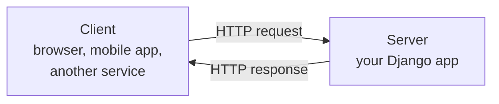
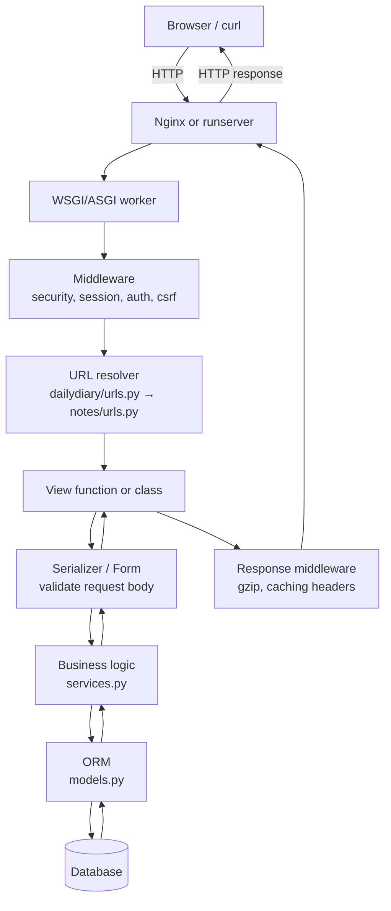
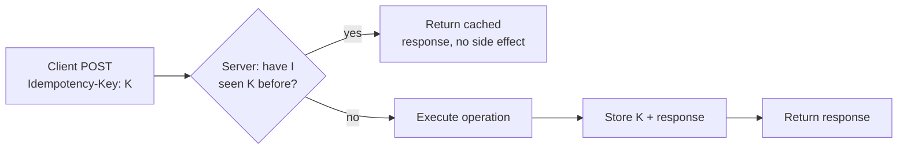

# API Guide — Everything you need when developing APIs

Reference document. Read top-to-bottom once; return to specific sections as you implement. Real examples use DailyDiary endpoints we'll build later and public APIs you'll recognize.

---

## 0 · What is an API, really?

An **API (Application Programming Interface)** is a *contract* between two programs: "if you send me a request in this shape, I promise a response in this shape." The web APIs we care about speak over **HTTP**.



An **endpoint** is one URL + method combination that fulfills one piece of the contract. Example: `POST /api/notes/` creates a note; `GET /api/notes/42/` reads note #42. They share a URL prefix but are *different endpoints*.

Three ways to classify APIs you'll meet:
- **REST** — resource-oriented, HTTP-native. Default choice. 90% of what you'll build.
- **RPC / gRPC** — function-call style; great for internal service-to-service.
- **GraphQL** — one endpoint, client specifies the shape of the response. Good when clients vary.

---

## 1 · HTTP — the layer everything sits on

### 1.1 Request anatomy

```
POST /api/notes/ HTTP/1.1              ← method, path, protocol
Host: dailydiary.app                   ← which server
Content-Type: application/json         ← what the body is
Authorization: Bearer eyJhbGci...      ← who you are
Accept: application/json               ← what you want back
                                       ← blank line separates headers from body
{"title": "Standup notes", "body": "..."}
```

### 1.2 Response anatomy

```
HTTP/1.1 201 Created                   ← status line
Content-Type: application/json
Location: /api/notes/42/               ← where the new thing lives
X-RateLimit-Remaining: 59

{"id": 42, "title": "Standup notes", "created_at": "2026-10-13T15:04:05Z"}
```

### 1.3 Methods — the verbs

| Method   | Means                     | Idempotent? | Safe? | Has body? |
|----------|---------------------------|-------------|-------|-----------|
| `GET`    | Read a resource           | Yes         | Yes   | No        |
| `POST`   | Create / do an action     | No          | No    | Yes       |
| `PUT`    | Replace a resource whole  | Yes         | No    | Yes       |
| `PATCH`  | Partial update            | No (usually)| No    | Yes       |
| `DELETE` | Remove                    | Yes         | No    | No        |
| `HEAD`   | Metadata only, no body    | Yes         | Yes   | No        |
| `OPTIONS`| Discover allowed methods / CORS preflight | Yes | Yes | No    |

- **Safe** = doesn't change server state (`GET`, `HEAD`, `OPTIONS`).
- **Idempotent** = calling it N times = calling it once. Critical for retries. A `POST /payments/` repeated creates N charges; a `PUT /notes/42/` repeated leaves one state.

### 1.4 Status codes — the ones you must know

| Range | Family       | When to use |
|-------|--------------|-------------|
| 1xx   | Informational| Rare in app code |
| 2xx   | Success      | 200 OK (standard), **201 Created** (new resource), 204 No Content (DELETE succeeded) |
| 3xx   | Redirect     | 301 permanent, 302 found, **304 Not Modified** (caching) |
| 4xx   | Client wrong | **400 Bad Request**, **401 Unauthorized** (no / bad credentials), **403 Forbidden** (good credentials, no permission), **404 Not Found**, 409 Conflict, 422 Unprocessable (validation), **429 Too Many Requests** |
| 5xx   | Server wrong | **500 Internal Error**, 502 Bad Gateway, 503 Unavailable, 504 Gateway Timeout |

**Pitfall:** `401` vs `403` is a classic interview question. "Who are you?" = 401. "I know who you are, you can't do this" = 403.

### 1.5 Headers that matter

| Header | Purpose |
|---|---|
| `Content-Type` | What *this* message's body is (`application/json`, `text/html`, `multipart/form-data`) |
| `Accept` | What formats the client can handle (server returns something matching) |
| `Authorization` | Credentials — `Bearer <token>`, `Basic <base64>`, custom |
| `Cookie` / `Set-Cookie` | Session identity |
| `Cache-Control`, `ETag`, `If-None-Match` | HTTP caching |
| `Idempotency-Key` | Client-generated UUID for safe retries on POST (Stripe pattern) |
| `X-Request-ID` | Trace a request through logs across services |

---

## 2 · REST — the dominant style

### 2.1 Six constraints (interview-ready list)

1. **Client-server** — separation of concerns.
2. **Stateless** — each request carries everything the server needs (no server-side session memory). *Session cookies are allowed; they're just an identifier to re-lookup state.*
3. **Cacheable** — responses say whether they can be cached and for how long.
4. **Uniform interface** — resources identified by URLs, manipulated via standard methods, self-descriptive responses.
5. **Layered system** — client can't tell whether it's talking to origin or a proxy / CDN / load balancer.
6. **Code on demand** (optional) — server can send executable code (JS); rarely cited.

### 2.2 Resource modeling

Think **nouns, not verbs**.

| Bad (RPC-leak)         | Good (REST)                                  |
|------------------------|----------------------------------------------|
| `POST /createNote`     | `POST /notes`                                |
| `GET /getNoteById?id=42` | `GET /notes/42`                           |
| `POST /deleteNote`     | `DELETE /notes/42`                           |
| `POST /notes/42/edit`  | `PATCH /notes/42` (or `PUT /notes/42`)       |

**Nested resources** for ownership:
```
GET  /users/5/notes          # all notes for user 5
POST /users/5/notes          # create a note for user 5
GET  /users/5/notes/42       # one specific note
```

**Non-CRUD actions** are the one place verbs sneak back in, as sub-resources:
```
POST /notes/42/summarize     # trigger an AI summarization
POST /orders/99/cancel       # business action that isn't DELETE
```

### 2.3 The classic CRUD table — for DailyDiary notes

| Intent                 | Method | Path                       | Status on success | Body |
|------------------------|--------|----------------------------|-------------------|------|
| List all my notes      | GET    | `/api/notes/`              | 200 OK            | JSON array (paginated) |
| Get one note           | GET    | `/api/notes/42/`           | 200 OK            | JSON object |
| Create a note          | POST   | `/api/notes/`              | 201 Created + `Location` | JSON of created object |
| Replace a note         | PUT    | `/api/notes/42/`           | 200 OK            | JSON of updated |
| Patch a note           | PATCH  | `/api/notes/42/`           | 200 OK            | JSON of updated |
| Delete a note          | DELETE | `/api/notes/42/`           | 204 No Content    | *(empty)* |
| Summarize a day        | POST   | `/api/days/2026-10-13/summarize/` | 202 Accepted or 201 | JSON of summary |

---

## 3 · The request lifecycle (how Django handles one)



The key engineering insight: **a request walks through layers each with one job**. Debugging means asking "which layer dropped it?" — error in middleware vs view vs ORM vs DB tells you where to look.

---

## 4 · Authentication & authorization

**Auth-N (authentication) = who are you?**
**Auth-Z (authorization) = are you allowed to do this?**

### 4.1 Mechanisms

| Scheme | How it works | Where used |
|---|---|---|
| **Session cookies** | Login → server sets `sessionid` cookie → browser sends it back automatically | Django default; browser-driven apps |
| **Basic auth** | `Authorization: Basic base64(user:pass)` every request | Internal / scripts only; must be HTTPS |
| **API keys** | Opaque string in header: `Authorization: Bearer sk_live_...` | Service-to-service, SaaS APIs (Stripe, Anthropic) |
| **JWT (JSON Web Tokens)** | Signed token encoding claims; server verifies signature, no DB lookup | SPAs, mobile apps, microservices |
| **OAuth 2.0** | Multi-step: user authorizes app at provider → provider gives app an access token | "Login with Google/GitHub", third-party integrations |

### 4.2 Real example — calling the Anthropic API (we'll do this in Phase 5)

```bash
curl https://api.anthropic.com/v1/messages \
  -H "x-api-key: $ANTHROPIC_API_KEY" \
  -H "anthropic-version: 2023-06-01" \
  -H "content-type: application/json" \
  -d '{
    "model": "claude-opus-4-7",
    "max_tokens": 1024,
    "messages": [{"role": "user", "content": "Summarize: ..."}]
  }'
```

Teaches 4 things at once: API key header, versioning header, JSON body, POST to a sub-resource.

### 4.3 Real example — JWT flow

```mermaid
sequenceDiagram
    participant U as User browser
    participant A as Auth API
    participant R as Resource API
    U->>A: POST /login {email, password}
    A-->>U: 200 {access_token: eyJ..., refresh_token: ...}
    U->>R: GET /notes with Authorization: Bearer eyJ...
    R->>R: Verify signature + check exp/claims
    R-->>U: 200 [...notes...]
    Note over U,R: Access token expires in 15min; U uses refresh to get a new one
```

### 4.4 Authorization patterns

- **RBAC (role-based):** user has roles (`admin`, `editor`); roles have permissions. Simple, scales to most apps.
- **ABAC (attribute-based):** policy evaluates attributes of (user, resource, env). Flexible, more complex.
- **Object-level permissions:** "User X owns Note Y" — check at the row level in every query (`.filter(owner=request.user)`).

**Rule we'll follow in DailyDiary:** every list / detail query starts with `Note.objects.filter(owner=request.user)` — no user ever sees another user's rows, enforced at the ORM boundary, not just the UI.

---

## 5 · Request & response shape

### 5.1 Query parameters — for filtering, sorting, pagination

```
GET /api/notes/?day=2026-10-13&ordering=-created_at&page=2&page_size=20
```

- `day=` filter
- `ordering=` sort (prefix `-` for descending)
- `page=`, `page_size=` pagination

### 5.2 Path parameters — for identifying resources

```
GET /api/notes/42/           ← 42 is a path param
GET /api/days/2026-10-13/    ← ISO date as a path param
```

### 5.3 Request body — JSON by convention

Validate every field. Reject unknown fields loudly or ignore quietly — pick one and document it. In Django + DRF, serializers do this for you.

### 5.4 Response envelopes

**Naked JSON (recommended default):**
```json
{"id": 42, "title": "Standup", "created_at": "2026-10-13T15:04:05Z"}
```

**Enveloped (used by some teams for uniformity):**
```json
{
  "data": {"id": 42, "...": "..."},
  "meta": {"request_id": "abc-123", "took_ms": 42},
  "errors": null
}
```

**List + pagination:**
```json
{
  "count": 157,
  "next": "/api/notes/?page=3",
  "previous": "/api/notes/?page=1",
  "results": [{"id": 42, "...": "..."}, ...]
}
```

### 5.5 Error responses — be helpful, be consistent

Bad:
```json
{"error": "something went wrong"}
```

Good (adopt or adapt — this is the **RFC 7807 "Problem Details"** shape):
```json
{
  "type": "https://dailydiary.app/errors/validation",
  "title": "Invalid note payload",
  "status": 422,
  "detail": "title must be 1-200 characters",
  "errors": {
    "title": ["This field may not be blank."]
  },
  "request_id": "abc-123"
}
```

---

## 6 · Idempotency, retries, and consistency

### 6.1 The problem

Network is unreliable. Client sends `POST /payments/ {amount:100}`, times out, retries → **two charges**.

### 6.2 The fix

**Idempotency key** — client generates a UUID per logical operation; server deduplicates.

```
POST /payments/
Idempotency-Key: 7f3c9a1e-...
{"amount": 100}
```

Server stores `(key, response)` for ~24h. A second call with the same key returns the cached response, not a new side effect.



### 6.3 Natural idempotency

`PUT /notes/42/ {title: 'X', body: 'Y'}` — safe to retry; final state is the same.
`DELETE /notes/42/` — second call returns 404 or 204; either way the end state matches.
`POST /notes/` — **not idempotent** without a key.

---

## 7 · Versioning

APIs evolve. Breaking changes need a version to live under.

| Strategy | Example | Trade-off |
|---|---|---|
| URL path | `/api/v1/notes/` | Explicit, easy to route; URL churn when upgrading |
| Header | `Accept: application/vnd.dailydiary.v1+json` | Clean URLs; harder to try in a browser |
| Query param | `/api/notes/?v=1` | Simple; can be forgotten |

Pragmatic default: URL path versioning (`/api/v1/`). Introduce `/api/v2/` only when you must break the contract; deprecate v1 with a sunset header.

---

## 8 · Pagination, filtering, sorting (list endpoints)

```
GET /api/notes/
    ?day=2026-10-13           ← filter
    &owner=5                  ← filter
    &ordering=-created_at     ← sort
    &page=2&page_size=20      ← page-number pagination
```

### Pagination styles

| Style | Pros | Cons |
|---|---|---|
| **Page number** (`?page=2`) | Simple; UI shows "page 3 of 10" | Breaks under rapid writes (items shift pages) |
| **Offset/limit** (`?offset=40&limit=20`) | Same as above, friendlier to SQL | Same consistency issue |
| **Cursor** (`?after=eyJpZCI6NDJ9`) | Stable under writes; infinite scroll | No "page 7 of N"; UI must be sequential |

Interview framing: use cursor for high-write feeds (Twitter-like), page-number for CRUD lists.

---

## 9 · Rate limiting

Prevents abuse and protects downstream services. Communicate with headers:

```
X-RateLimit-Limit: 60
X-RateLimit-Remaining: 42
X-RateLimit-Reset: 1697212800
Retry-After: 30                 ← on a 429
```

Common algorithms:
- **Fixed window** — simplest; prone to burst at window boundary.
- **Sliding window** — smooths bursts.
- **Token bucket** — allows bursts up to bucket size; standard choice.

---

## 10 · CORS (Cross-Origin Resource Sharing)

Browsers block JS on `app.com` from calling `api.app.com` unless the API responds with permissive CORS headers.

```
Access-Control-Allow-Origin: https://app.dailydiary.com
Access-Control-Allow-Methods: GET, POST, PUT, DELETE
Access-Control-Allow-Headers: Authorization, Content-Type
Access-Control-Allow-Credentials: true
```

**Preflight:** before a non-simple request, browser sends `OPTIONS` to check. Your server must respond to `OPTIONS` even if you didn't code it. In Django, the `django-cors-headers` package does this.

---

## 11 · OpenAPI / Swagger — the API's contract as a file

Write (or generate) a YAML/JSON spec of every endpoint. From it you get: interactive docs (Swagger UI), client SDKs (openapi-generator), request validation, and mock servers.

Snippet:

```yaml
paths:
  /api/notes/{id}/:
    get:
      summary: Get a note
      parameters:
        - in: path
          name: id
          required: true
          schema: {type: integer}
      responses:
        '200':
          description: The note
          content:
            application/json:
              schema: {$ref: '#/components/schemas/Note'}
        '404': {description: Not found}
```

**Django tooling:** `drf-spectacular` generates the OpenAPI spec from DRF serializers + views. Interview-worthy: "we treat the OpenAPI file as the source of truth and generate clients from it."

---

## 12 · Testing APIs

### 12.1 From the command line — `curl`

```bash
# GET
curl -s http://localhost:8000/api/notes/ | jq

# POST with JSON
curl -X POST http://localhost:8000/api/notes/ \
  -H 'Content-Type: application/json' \
  -H "Authorization: Bearer $TOKEN" \
  -d '{"title":"test","body":"hello"}'

# Just the status code
curl -s -o /dev/null -w "%{http_code}\n" http://localhost:8000/api/notes/42/

# Follow redirects, show headers
curl -iL http://localhost:8000/
```

### 12.2 GUI tools

- **Postman** / **Insomnia** — build collections, save envs, run suites.
- **HTTPie** — nicer CLI (`http POST localhost:8000/api/notes/ title=hi`).
- **REST Client** VS Code extension — `.http` files in the repo, versioned.

### 12.3 Automated tests (Django)

```python
# notes/tests.py
from django.test import TestCase
from django.urls import reverse

class HomeViewTests(TestCase):
    def test_home_returns_200(self):
        response = self.client.get(reverse("home"))
        self.assertEqual(response.status_code, 200)
        self.assertContains(response, "DailyDiary")
```

For JSON APIs with DRF: `APIClient` + `response.json()`.

---

## 13 · Django specifics (and when to reach for DRF)

### 13.1 Django vanilla — function-based view returning JSON

```python
# notes/views.py
from django.http import JsonResponse
from django.views.decorators.http import require_http_methods

@require_http_methods(["GET"])
def note_list(request):
    data = [{"id": n.id, "title": n.title} for n in request.user.notes.all()]
    return JsonResponse({"results": data})
```

### 13.2 Django Rest Framework (DRF) — same, cleaner

```python
# notes/serializers.py
from rest_framework import serializers
from .models import Note

class NoteSerializer(serializers.ModelSerializer):
    class Meta:
        model = Note
        fields = ["id", "title", "body", "created_at"]

# notes/views.py
from rest_framework import viewsets, permissions
from .serializers import NoteSerializer
from .models import Note

class NoteViewSet(viewsets.ModelViewSet):
    serializer_class = NoteSerializer
    permission_classes = [permissions.IsAuthenticated]

    def get_queryset(self):
        return Note.objects.filter(owner=self.request.user)

# notes/urls.py
from rest_framework.routers import DefaultRouter
router = DefaultRouter()
router.register(r"notes", NoteViewSet, basename="note")
urlpatterns = router.urls
```

**Four lines of config = all five CRUD endpoints + pagination + filtering + auth.** That's why DRF is standard for Django REST APIs. We'll adopt it when we add JSON endpoints (around Phase 3 or 5).

### 13.3 When to use what

| You're building | Use |
|---|---|
| Server-rendered HTML pages | Django views + templates (what Phase 1.5 does) |
| JSON API for a JS/mobile client | Django Rest Framework (DRF) |
| Flexible-shape queries | GraphQL (`graphene-django`) |
| Super-fast async service | FastAPI (separate from Django) |

---

## 14 · Security checklist (bake these in, don't bolt on)

- [ ] **HTTPS everywhere** in prod (`SECURE_SSL_REDIRECT = True`)
- [ ] **CSRF** on cookie-authed state-changing requests (Django does this by default)
- [ ] **Input validation** at the serializer boundary (never trust the client)
- [ ] **Authorization checks per object** (`.filter(owner=request.user)`)
- [ ] **Rate limit** auth endpoints and expensive endpoints (AI summarize!)
- [ ] **No secrets in logs** (filter `Authorization` headers)
- [ ] **No PII in URLs** (they end up in logs, referrers, browser history)
- [ ] **CORS** restricted to known origins
- [ ] **Security headers** — HSTS, X-Frame-Options, CSP (`django-csp`)
- [ ] **Dependency scanning** (Dependabot, `pip-audit`)

---

## 15 · Observability — you need this on day one for anything AI

For every API call, log:
- `request_id` (generate at ingress, pass through everywhere)
- user id (if authed)
- route (`GET /api/notes/`)
- status code
- latency ms
- bytes in / out

For AI calls specifically, also log:
- model id
- prompt version
- tokens in / out
- cost estimate
- cache hit / miss
- latency broken down (your logic vs network vs model)

In production you'd ship these to a tool like Datadog, Honeycomb, or an ELK stack. In dev, structured JSON logs to stdout are fine.

---

## 16 · The DailyDiary API — forward reference

What this project will expose (building incrementally; current state is "none"):

```
# Phase 2 (auth)
POST   /accounts/signup/
POST   /accounts/login/
POST   /accounts/logout/
GET    /accounts/profile/
PATCH  /accounts/profile/

# Phase 3 (notes CRUD, HTML pages)
GET    /notes/                    # list
GET    /notes/new/                # form
POST   /notes/                    # create
GET    /notes/<id>/               # detail
POST   /notes/<id>/edit/          # update
POST   /notes/<id>/delete/        # delete

# Phase 4 (calendar)
GET    /calendar/<yyyy>/<mm>/     # month view
GET    /calendar/<yyyy>/<mm>/<dd>/# day view, 24h grid

# Phase 5 (AI)
POST   /days/<yyyy>-<mm>-<dd>/summarize/   # trigger a summary
GET    /days/<yyyy>-<mm>-<dd>/summaries/   # list summaries for the day
DELETE /summaries/<id>/

# Phase 6+ (JSON API; DRF-backed)
GET /api/v1/notes/
POST /api/v1/notes/
...
```

We'll justify every URL choice in `SYSTEM_DESIGN.md` as we add them.

---

## 17 · Interview talking points this doc gives you

- Difference between 401 and 403.
- Why `POST` isn't idempotent and how `Idempotency-Key` fixes it.
- Pagination trade-offs (page vs cursor).
- Rate-limiting algorithms (token bucket).
- Why URL versioning beats header versioning for debuggability.
- CORS preflight — what triggers an `OPTIONS` call.
- When to pick DRF over hand-rolled JSON views (serializer + viewset + router savings).
- How you'd log an AI API call to make it debuggable in production.
