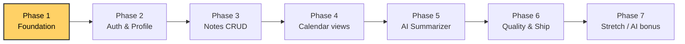
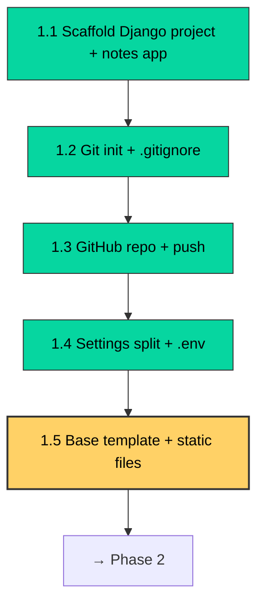

# Progress Tracker

Live state of the project. Updated after every accepted step.

**Project:** DailyDiary — Notes Calendar with AI Summarization
**Django project module:** `dailydiary` · **First app:** `notes`
**Framework:** Django 5.x (Python)
**Started:** 2026-10-12
**Current phase:** Phase 1 — Foundation
**Next step:** 1.5 — Base template + static files setup
**Django version installed:** 5.2.18
**Repo:** https://github.com/Kunalsingh29/dailydiary (public, `main` pushed)
**Branching convention:** `feature/<step>-<slug>` → PR → merge → delete branch

---

## You are here (overall flow)

## Phase 1 — detailed step flow

---

## Status legend
- ⬜ Not started
- 🟡 In progress / proposed, awaiting your accept
- ✅ Done
- ❌ Rejected / dropped (with reason)

---

## Running log

| Date       | Step  | Status | Notes |
|------------|-------|--------|-------|
| 2026-10-12 | 0.0   | ✅     | Chose Django as framework |
| 2026-10-12 | 0.1   | ✅     | Created `PROJECT_ROADMAP.md` and `PROGRESS_TRACKER.md` |
| 2026-10-12 | 0.2   | ✅     | Named project `dailydiary` (product name DailyDiary); added `SYSTEM_DESIGN.md` for HLD/LLD; added flowcharts to tracker |
| 2026-10-12 | 1.1   | ✅     | Scaffolded `dailydiary` project + `notes` app on Django 5.2.18; `manage.py check` clean |
| 2026-10-12 | 1.2   | ✅     | Git init on `main`; `.gitignore` + `.env.example` + README seed; first commit `92b4c1a` (20 files, 706+) |
| 2026-10-12 | 1.3   | ✅     | Installed `gh` 2.102.0, authed as Kunalsingh29, created public repo `dailydiary`, pushed `main` |
| 2026-10-12 | 1.4   | ✅     | Branch `feature/1.4-settings-env`; `python-decouple` wired; `.env` created; `notes` added to INSTALLED_APPS; migrations applied; runserver returns HTTP 200 (LLD-6) |

---

## Decisions log

Why we chose things (so we don't re-litigate later).

| Date       | Decision | Why |
|------------|----------|-----|
| 2026-10-12 | Django over FastAPI | User wants to learn Django; built-in auth/ORM/admin fits a CRUD + templates app. |
| 2026-10-12 | SQLite for dev, Postgres-ready | Zero setup to start; swap connection string later. |
| 2026-10-12 | Anthropic Claude for summarization | Matches user's AI-engineer goal; good at structured output. |

---

## Open questions / to decide later

- [ ] Which Claude model id to default to (will decide at Phase 5 after reading current docs).
- [ ] Do we use HTMX for the calendar interactions, or vanilla JS?
- [ ] Hosting target for deploy phase (Fly.io vs Render vs Railway).
- [ ] Timezone source: profile setting vs browser detection vs both.

---

## Current snippet under review

*(This section holds the code I'm proposing right now. You accept / reject / modify here before I write any files.)*

**Nothing proposed yet.** Phase 1.1 is done. Reply "go" or "next" in chat and I'll propose Phase 1.2 (Git init + `.gitignore`).
