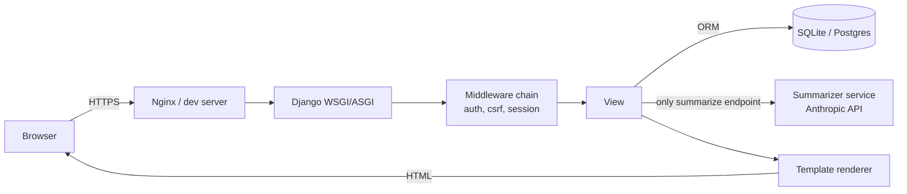
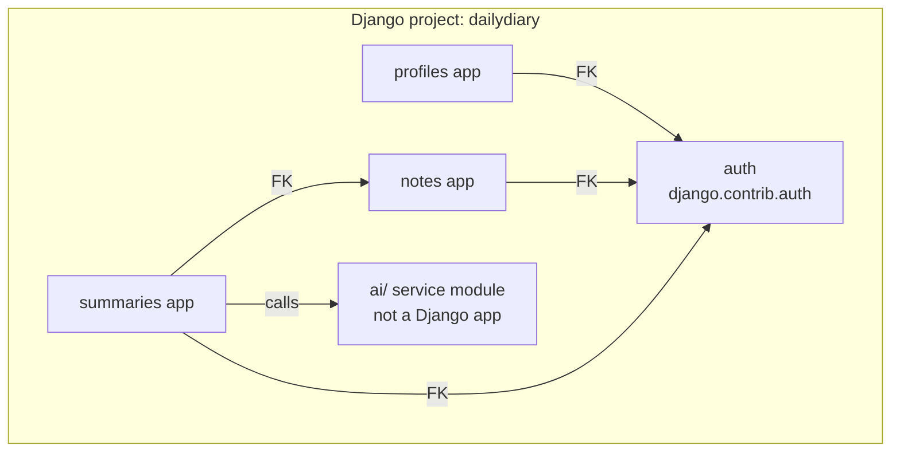
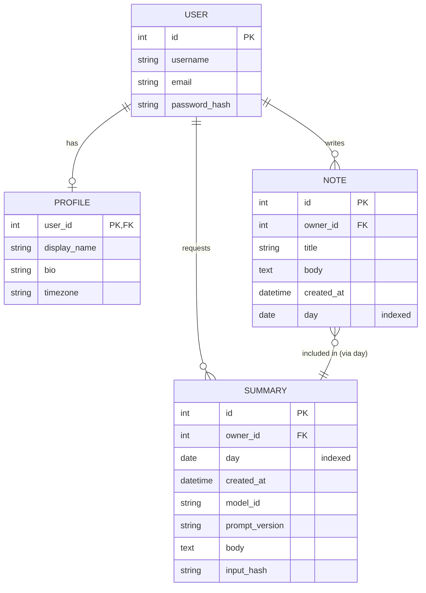
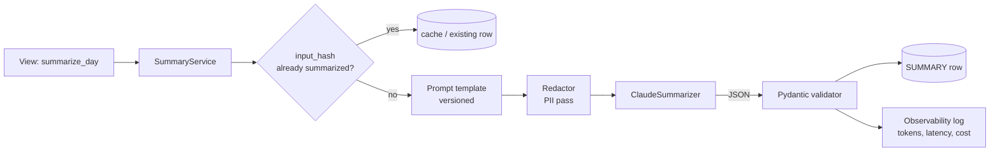

# System Design Notes — DailyDiary

Living document. Every architectural or design-pattern decision we make goes here with the *why*, so this project doubles as a reference you can walk an interviewer through.

**Two lenses:**
- **HLD (High-Level Design):** boxes-and-arrows. Services, data stores, external systems, request paths, scaling concerns, failure modes.
- **LLD (Low-Level Design):** inside one box. Classes, interfaces, data models, patterns (Factory, Strategy, Repository…), concurrency, API contracts.

Each entry has: **Context → Options → Decision → Why → Trade-offs → Interview framing**.

---

## HLD-1 · Overall system shape (monolith first)

**Context:** DailyDiary needs: auth, notes CRUD, calendar views, AI summarization. Single user per request. Low traffic (personal/learning project).

**Options considered:**
1. Single Django monolith.
2. Django for web + FastAPI microservice for AI calls.
3. Full microservices (auth svc, notes svc, ai svc).

**Decision:** Start with **(1) monolith**, carve out AI into a service module with a clean interface so (2) is one refactor away.

**Why:**
- YAGNI — microservices solve team/scaling problems we don't have.
- A single deploy = fastest feedback loop while learning.
- The AI call is the only likely bottleneck; isolating it *behind an interface* now gets us 80% of the microservice benefit at 0% of the ops cost.

**Trade-offs:** If AI load grows, we extract. The interface boundary is the insurance policy.

**Interview framing:** "I defaulted to a monolith because scaling pressure wasn't real, but I kept the AI boundary explicit — a `Summarizer` protocol with one implementation today, swappable for a remote service tomorrow. That's the 'start with a modular monolith' pattern."

---

## HLD-2 · Request flow (current)

The AI path is the only one that calls an external service — treat it as the integration point to isolate, retry, log, and cache.

---

## HLD-3 · Data stores

**Decision:** One relational DB (SQLite in dev, Postgres in prod). No cache layer yet.

**Why:** Our hot queries ("notes for user on day X") are trivially indexable (`owner_id`, `day`) and cheap. Cache = premature complexity.

**Future hooks we're leaving in:**
- Summaries are already keyed by an `input_hash` → that's a cache primitive.
- If we add retrieval (embeddings), we'll add a vector store (pgvector keeps us single-DB).

---

## HLD-4 · External dependencies & failure handling

| Dependency | Blast radius if down | Mitigation |
|---|---|---|
| Anthropic API | Only the "Summarize" button fails | Timeout + retry (1x) + user-visible "try again" + log the error |
| Database | Whole app down | Standard — single DB is fine for this scale |
| GitHub (CI only) | Can't merge; app unaffected | None needed |

Rule we'll follow: **the UI must never hang on an external call**. Summarize is a POST that returns a status; the page refreshes to show the summary row.

---

## LLD-1 · App boundaries inside the monolith

**Why split by feature, not by layer:** Django's "app" is a feature module. Keeping `notes`, `profiles`, `summaries` separate means we can delete or extract one without unpicking a shared `models.py`. The `ai/` folder is deliberately **not** a Django app — it has no models, no URLs, no templates. It's a pure Python service module. That boundary is important later.

---

## LLD-2 · Patterns we will deliberately use

| Pattern | Where | Why |
|---|---|---|
| **Repository (light)** | Not for Django models (ORM already is one), but *will* use for the AI call: `Summarizer` protocol + `ClaudeSummarizer` impl | Lets tests swap in a `FakeSummarizer`, demonstrates DI |
| **Strategy** | Prompt templates — multiple prompt versions selectable at runtime | Shows versioning/evaluation discipline |
| **DTO + Pydantic validation** | AI response parsing | Protects the DB from garbage LLM output |
| **Service layer** | `notes/services.py` wraps business logic (e.g., "save note with user tz") | Keeps views thin; interview talking point for separation of concerns |
| **Factory** | `ai/factory.py` picks summarizer impl from settings | Classic dependency wiring |

Patterns we are **not** using and why:
- Full CQRS — overkill for CRUD.
- Event sourcing — same.
- GraphQL — Django templates do the job.

---

## LLD-3 · Data model (planned, will update as we build)

Indexing plan: `(owner_id, day)` composite index on `NOTE` and `SUMMARY` — covers both "notes on day X" and "all summaries for user Y".

---

## LLD-4 · AI subsystem (will flesh out at Phase 5)

Key LLD decisions here (we'll justify each when we build):
- **Idempotency via `input_hash`** = hash of (sorted note ids + their updated_at). Same inputs → same cached summary.
- **Structured output** = ask the model for JSON; validate; reject-and-retry on parse failure (once).
- **Prompt as a file**, not a string literal — versioned in Git.
- **Config-driven model id** — swap models without a code change.

---

## Running decisions log (short form)

| Date | ID | Decision |
|---|---|---|
| 2026-10-12 | HLD-1 | Monolith with isolated AI service module |
| 2026-10-12 | HLD-3 | Single Postgres-compatible DB, no cache layer |
| 2026-10-12 | LLD-1 | Feature-based Django apps; `ai/` is a non-app module |
| 2026-10-12 | LLD-2 | Repository + Strategy + DTO patterns on the AI path |

---

## How to use this doc in interviews

- **HLD question** ("design a daily journal with AI summaries"): walk HLD-1 → HLD-2 → HLD-3 → HLD-4. Show you reasoned about blast radius and scaling.
- **LLD question** ("design the summarizer class"): walk LLD-4, then LLD-2 for the patterns, then LLD-3 for the schema.
- **"Why Django not FastAPI?"**: HLD-1 trade-off — batteries included, speed to a working auth+ORM+admin, acceptable until the AI path dominates load.
